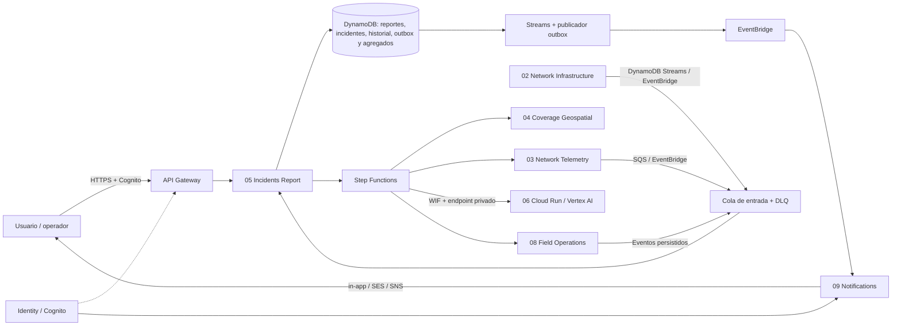

# Arquitectura y operacion de Red TeleCorp

## Flujo integrado

## Agregados y metricas

`GET /incidencias/metricas` acepta `zona=ZONE-01`, `zonas=ZONE-01,ZONE-02` (hasta 10) o sin filtro para consultar todas las zonas. El intervalo admite hasta 31 dias. Los eventos alimentan agregados diarios en DynamoDB con escrituras transaccionales e idempotentes. El endpoint consulta esos agregados en vez de recorrer todos los reportes y limita la lectura a 50.000 filas agregadas por solicitud.

La respuesta incluye conteos por zona, tipo de problema, antena, criticidad y tiempo medio de resolucion. `antenasRecurrentes` usa una regla operativa inicial: tres episodios de falla dentro de siete dias, repartidos en al menos dos dias distintos. Los valores son configurables mediante `RECURRENT_ANTENNA_MIN_EVENTS`, `RECURRENT_ANTENNA_MIN_DAYS` y `RECURRENT_ANTENNA_WINDOW_DAYS`.

Un episodio cuenta cuando una antena pasa de estado normal o desconocido a DOWN, DISABLED o SATURATED. Cambios entre dos estados de falla no cuentan como episodios separados. Al alcanzar el umbral, si la antena vuelve a fallar y no hay otro incidente abierto en la zona, el flujo de Step Functions marca riesgo alto y solicita una orden de mantenimiento de prioridad alta mediante Field Operations. Es una regla inicial configurable, que el equipo de operaciones debe calibrar con datos reales.

La nueva tabla de agregados tiene TTL de 400 dias, cifrado y retencion frente a eliminacion del stack. La proyeccion comienza al desplegar el servicio; el historico anterior no se carga automaticamente. El endpoint informa esta limitacion. Hace falta ejecutar un backfill para presentar periodos previos al despliegue. La proyeccion es secundaria: los errores se registran sin detener la gestion de incidencias. Antes de usar este tablero para decisiones de SLA, hacen falta alarmas de error y un reconciliador/backfill operativo.

## Procesamiento por lotes y limites restantes

El detector colectivo pagina los reportes por zona y se detiene tan pronto como alcanza el numero configurado de usuarios distintos; no carga todos los reportes solo para decidir si se cumple el umbral. Las metricas se agregan por evento y se leen como resumen diario, por lo que no requieren escanear la tabla de reportes.

El flujo de consolidacion conserva los limites de 30 antenas y 1.000 reportes porque Step Functions y el incidente aun transportan esas referencias para actualizar reportes y notificar destinatarios. Para eliminar esos limites hay que persistir la relacion incidente-reporte en una tabla y procesar las referencias en lotes con continuacion durable o Distributed Map. No se debe aumentar el limite de forma aislada porque podria superar el tamaño maximo del estado de Step Functions.

## Reportes y seguridad

Los reportes nuevos requieren numero de servicio; la identidad se toma del `sub` autenticado de Cognito. La fecha de registro se asigna en servidor y se guarda aparte de `occurredAt`, que acepta `fechaHora` o `occurred_at` ISO opcional, sin fecha futura. La zona representa la ubicacion aproximada. Email y telefono deben proceder del perfil verificado de Identity.

## Canales y despliegue

Las preferencias in-app se pueden validar dentro de AWS. Email requiere identidad SES verificada; SMS requiere SNS, cuotas y permisos. Ambos canales necesitan configuracion y pruebas de entrega con destinatarios controlados.

`deploy_all.sh` prepara los servicios AWS y genera un entorno Postman con URLs del despliegue. La politica de `LabRole` debe permitir lectura y escritura en la tabla de agregados y en los contadores diarios de `STATE_TABLE`. Cloud Run, Vertex AI, Secret Manager y WIF requieren recursos y permisos configurados en el proyecto GCP. Oracle Spatial es opcional. El diagrama describe el diseno y no demuestra que los recursos externos esten desplegados.

Antes de presentar, obtener evidencia de una ejecucion real que cubra login Cognito, reporte autenticado, deteccion colectiva, orden de campo, notificacion y cierre tras recuperacion. Indicar que proveedores y canales estuvieron activos.
